# Kubernetes Microservices Shop

A microservice shop with four tiers (frontend, backend API, database, cache), packaged as one Helm chart. Each tier runs in its own namespace, and the app survives rolling updates, pod failures, load spikes and database restarts.

Resilience tests pass [Test results](#test-results).

## Architecture

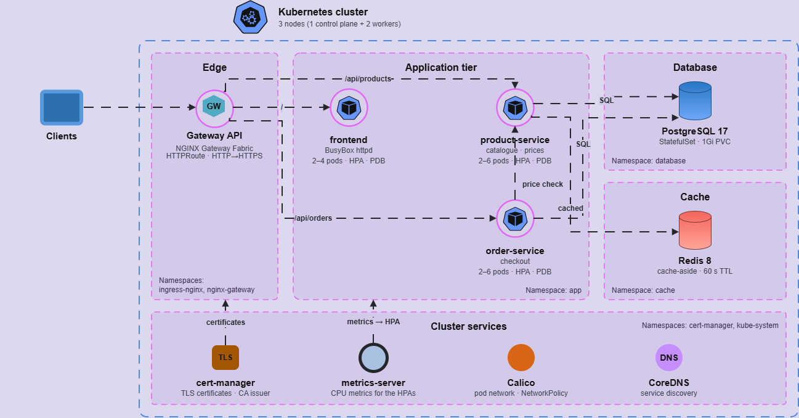

**Request path**

1. Clients reach the cluster through a **Gateway API** Gateway run by **NGINX Gateway Fabric**. It terminates TLS with a certificate from **cert-manager** and redirects plain HTTP to HTTPS.
2. An **HTTPRoute** sends `/` to the **frontend**, `/api/products` to **product-service** and `/api/orders` to **order-service**, removing the `/api` prefix on the way.
3. **product-service** reads the catalogue from **PostgreSQL** and caches it in **Redis** for 60 seconds (cache-aside).
4. **order-service** asks product-service for the current price, then writes the order to PostgreSQL.
5. The backends reach the data tier by its full DNS name, e.g. `postgres-svc.database.svc.cluster.local`.

## How to Run

**1. Build and push the backend images to Docker Hub**

```bash
export DOCKERHUB_USER=<your-dockerhub-username>
docker login

# deploy the images to dockerhub
docker build -t $DOCKERHUB_USER/product-service:v1.0.0 backend/product-service
docker build -t $DOCKERHUB_USER/order-service:v1.0.0 backend/order-service
docker push $DOCKERHUB_USER/product-service:v1.0.0
docker push $DOCKERHUB_USER/order-service:v1.0.0

# v1.0.1: the new version used by the zero-downtime test
docker build -t $DOCKERHUB_USER/product-service:v1.0.1 backend/product-service
docker push $DOCKERHUB_USER/product-service:v1.0.1
```

**2. Install the whole application with one Helm command**

```bash
helm upgrade --install microservice-shop helm/application \
  -f helm/application/values-prod.yaml \
  --set secrets.postgresPassword='<password>' \
  --set secrets.redisPassword='<password>' \
  --wait --timeout 10m
```

Every Deployment is fully available and every pod is Running.

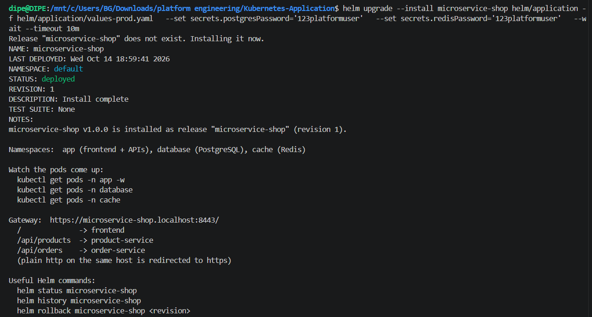

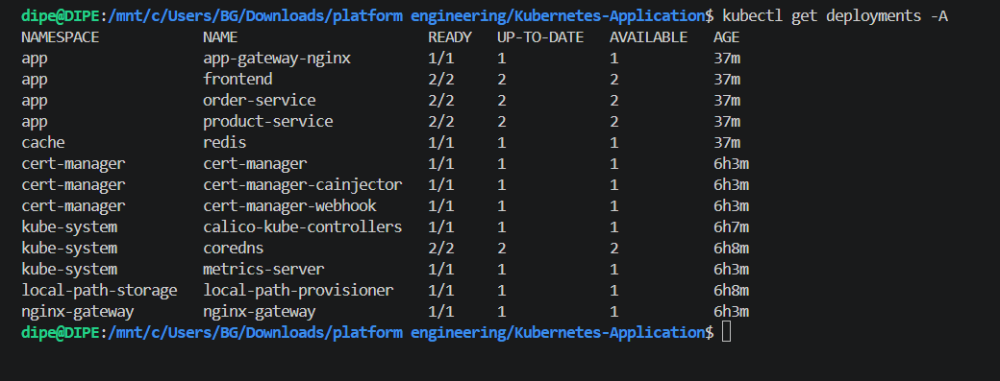

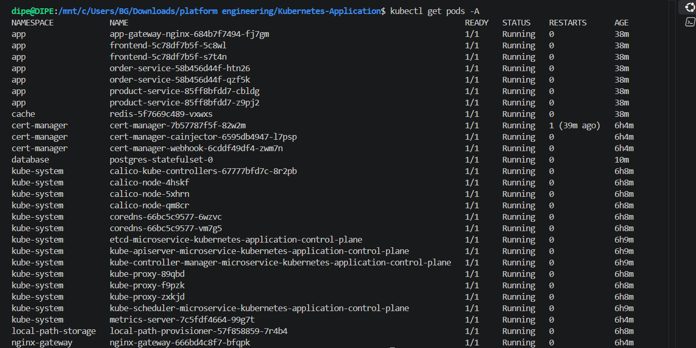

**3. Open the shop** at `https://microservice-shop.localhost:8443`

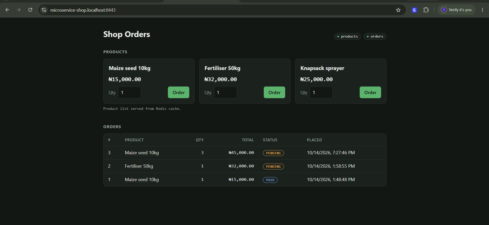

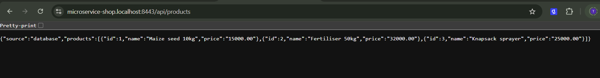

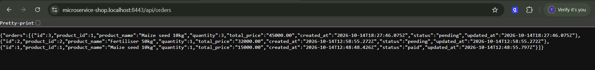

## Test results

Scripts are in [`tests/`](tests/) and output is in [`results/`](results/). Load is generated with [k6](https://k6.io).

### 1. Zero-downtime deploy: `bash tests/zero-downtime.sh`

k6 sends 50 requests/s, half to the API and half to the page, while product-service is updated with `kubectl set image` to a new version.

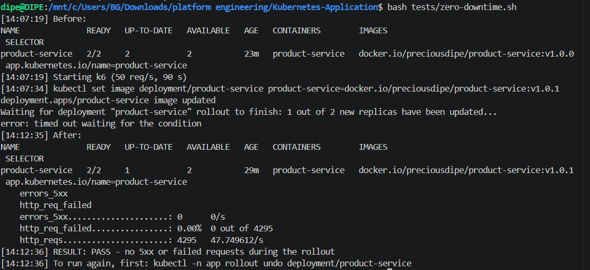

**How:**
- The rolling update uses `maxSurge: 1` and `maxUnavailable: 0`, so a new pod must be Ready before an old one is removed.
- A readiness probe on `/healthz` keeps traffic away from pods that aren't ready.
- A `preStop` delay lets a stopping pod finish its in-flight requests.

### 2. Self-healing: `bash tests/self-healing.sh`

A product-service pod and a frontend pod are deleted. Their ReplicaSets create replacements immediately, and the remaining replica keeps serving.

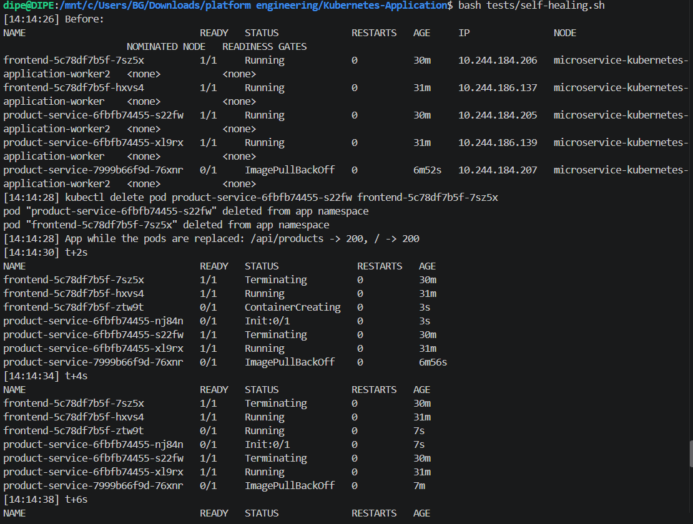

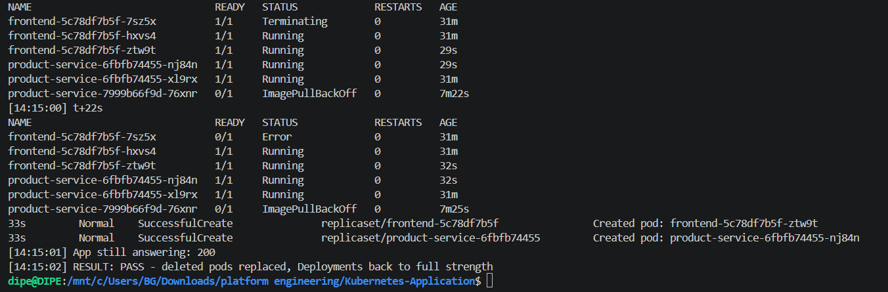

### 3. Auto-scaling: `bash tests/autoscaling.sh`

k6 ramps `/api/products` to 200 requests/s. The HPA adds pods as CPU passes the target and removes them after the load stops.

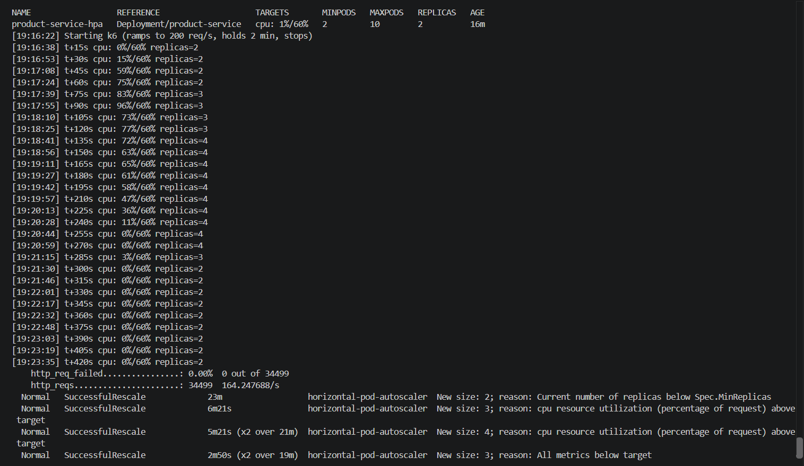

**How:**
- The HPA targets a percentage of each pod's CPU request.
- The `behavior` settings scale up quickly (2 pods every 15 s) and scale down slowly (a 60 s wait, then 1 pod every 30 s).

### 4. Data persistence: `bash tests/data-persistence.sh`

An order is created, then `postgres-statefulset-0` is deleted. The StatefulSet recreates the pod with the same name, which reattaches the same volume (`data-postgres-statefulset-0`). The PVC ID is unchanged, the pod ID is new, and the order is still there.

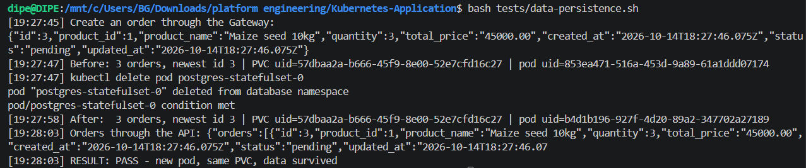

## Security

- **Namespace isolation.** `app`, `database` and `cache` are separate namespaces. Pod Security Admission is set to `restricted` on all three.
- **Network policies:**
  - every namespace starts with deny-all plus DNS-only egress
  - each pod then gets exactly the connections it needs:
    - Gateway → frontend and backends
    - backends → PostgreSQL
    - product-service → Redis
    - order-service → product-service
  - everything else, including internet egress, is blocked
- **Secrets:**
  - the database and Redis passwords live in the Secret `apps-secret`, one copy per namespace
  - they are passed at install time (`--set` or a private values file) and are never committed
  - the chart refuses to install without them
- **Non-root containers:**
  - every pod runs as a non-root user, with a read-only root filesystem where possible
  - all Linux capabilities are dropped, privilege escalation is off, and the seccomp profile is `RuntimeDefault`
- **Resource limits.** Every container, including init containers, has CPU and memory requests and limits.

Pod anti-affinity is setup with each service having two replicas on different worker nodes.

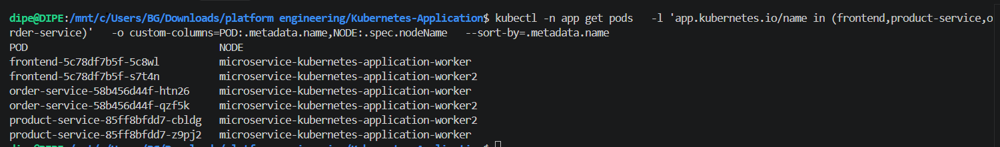

